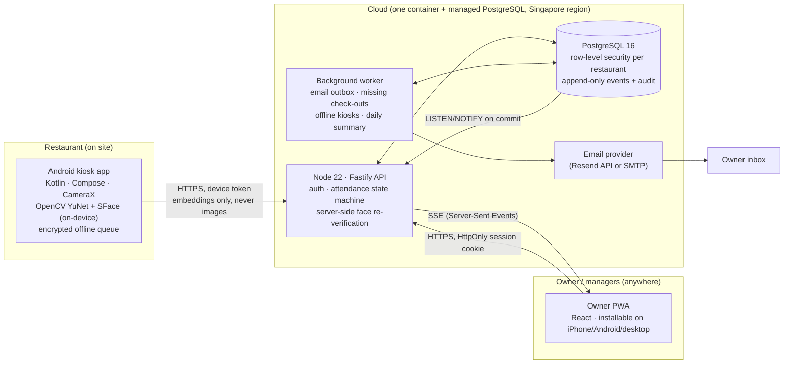

# Architecture & decisions

## System overview



ASCII version:

```
 Android kiosk ──HTTPS(device token, 128-float embeddings)──▶ ┌──────────── API + worker (Node) ───────────┐
   camera opens only after CHECK IN / CHECK OUT tap           │ attendance state machine · re-verify face   │──▶ Email (Resend/SMTP)
   YuNet detect → SFace embed → local 1:N match               │ SSE hub ◀── LISTEN/NOTIFY ──┐               │
   encrypted offline queue → replays on reconnect             └──────────────┬──────────────┼───────────────┘
 Owner PWA ◀──SSE live updates── / ──HTTPS cookie──▶                         ▼              │
                                                              PostgreSQL (RLS per restaurant, append-only events)
```

## Components

| Component | Tech | Why |
|---|---|---|
| Kiosk app | Kotlin, Jetpack Compose, CameraX, OpenCV 4.10 (Maven Central AAR) | Native camera control, low latency, works offline, runs on cheap Android tablets |
| Face detection | YuNet (`face_detection_yunet_2023mar.onnx`, MIT) | Small (230 KB), fast on CPU, gives 5 landmarks for alignment and the head-turn liveness check |
| Face recognition | SFace (`face_recognition_sface_2021dec.onnx`, Apache-2.0) | Commercial-friendly licence, runs on-device via OpenCV DNN, 128-d embeddings, no per-call fees |
| Owner dashboard | React + Vite PWA | One codebase for iPhone, Android and desktop, no App Store needed |
| API | Node 22, Fastify, Zod, `pg` | Small, fast, typed; easy to host anywhere |
| Database | PostgreSQL 16 | Transactions and unique indexes guarantee "exactly once"; RLS for tenant isolation; LISTEN/NOTIFY for realtime |
| Realtime | Postgres LISTEN/NOTIFY → Server-Sent Events | No extra service; NOTIFY fires only on COMMIT so dashboards never show uncommitted data; works across instances |
| Email | Transactional outbox table + worker, Resend HTTP API or SMTP | Attendance never waits for email; retries with backoff; dedupe keys prevent duplicates; delivery status visible |

## Key decisions

1. **On-device recognition, server re-verification.** The kiosk does detection, embedding and 1:N matching locally (fast, works
   offline, no video leaves the device). It sends only the 128-number probe embedding with each event; the server re-runs the
   match against its encrypted templates and rejects the event if it disagrees (`identity_mismatch`). A tampered kiosk cannot
   simply claim someone else's identity.
2. **Button decides the action, server decides if it is allowed.** The requested action is never changed. The server state
   machine enforces one open session per employee with a partial unique index (`attendance_sessions_one_open_idx`) and a row
   lock on the employee, so two kiosks tapping at once cannot create two sessions.
3. **Idempotency by client event id.** The kiosk generates a UUID when the employee taps the button; every retry, repeated
   camera frame and offline replay reuses it. `attendance_events.id` is the primary key, so the event is stored once.
4. **Immutable facts, layered corrections.** Events cannot be updated (trigger) or deleted (no grant + trigger). Corrections
   are separate records; approved corrections set `corrected_*` fields on the derived session while originals stay intact.
5. **Tenant isolation in the database.** Every tenant table has `restaurant_id` and a row-level security policy keyed on
   the per-transaction setting `app.restaurant_id`. The app connects as a non-owner role, so a query that forgets its
   `WHERE restaurant_id` still cannot see another restaurant. Composite foreign keys `(restaurant_id, id)` stop cross-tenant
   references. The server warns at startup if RLS is bypassed by the connection role.
6. **Timestamps.** Stored as UTC `timestamptz`. Online events use server time. Offline events keep the device timestamp as
   `event_time` and `device_timestamp`, plus `server_received_at` (sync time). Future-dated or stale offline events are saved
   as `pending_review`. Display and shift rules use the restaurant IANA zone (default `Asia/Kuala_Lumpur`).
7. **One deployable unit.** API, worker and static PWA in a single container. Workers use `FOR UPDATE SKIP LOCKED`, so
   running two instances is safe. No microservices.

## Data model (summary)

`restaurants` → `branches`, `employees`, `shifts`, `shift_assignments`, `devices`, `face_enrollments` → `face_templates`
(encrypted), `employee_photos` (optional), `attendance_sessions` (derived, one per check-in) ← `attendance_events`
(immutable facts), `attendance_corrections`, `attendance_exceptions` (alerts), `notification_settings`,
`notification_outbox`, `audit_logs` (append-only). Global: `users`, `memberships` (role per restaurant), `user_sessions`,
`app_releases`. Full DDL: `server/migrations/001_init.sql`.

Biometric data is split from profile data: `face_templates` holds AES-256-GCM ciphertext (per-row IV; additional
authenticated data `restaurant:employee` so a row cannot be moved to another employee), with versioned keys from
`TEMPLATE_KEYS`. Deleting templates leaves attendance records intact.

## Attendance state machine

```
             CHECK IN (verified identity)                 CHECK OUT (verified identity)
 [no open session] ───────────────────────▶ [open session] ───────────────────────────▶ [closed]
       │  CHECK OUT → 409 no_active_session      │  CHECK IN → 409 already_checked_in
       │                                         │  CHECK OUT < min gap → 409 too_soon
       │                                         │  open > max_session_hours → missing_checkout (closed, flagged)
       │                                         │  past scheduled end + grace → flagged, stays open
 offline events that conflict with the server state → stored as pending_review + alert (never silently applied)
```

## Repository layout

```
attendance/
  server/        API, worker, migrations, tests (node:test, real PostgreSQL)
  web/           Owner PWA (React + Vite)
  android/       Kiosk app (:core pure-Kotlin logic + tests, :app Android)
  models/        ONNX models (downloaded by scripts/fetch-models.sh, SHA-256 pinned, not committed)
  tools/face-eval/  Recognition pipeline check on public photos
  docs/          This documentation
  deploy/        Database role setup
  Dockerfile, render.yaml, .env.example
```
